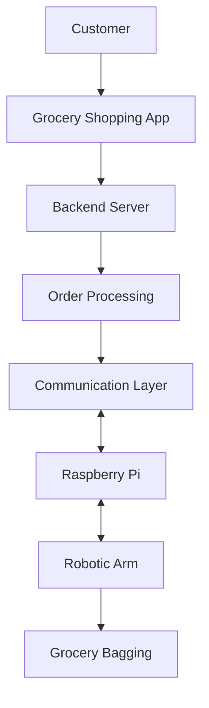

# BagBot 🛒🤖

**BagBot is a work-in-progress project exploring automated grocery bagging through a grocery shopping application and a robotic arm.**

The goal is to connect online grocery ordering with physical automation, allowing grocery orders to be translated into instructions for a robotic arm to bag items.

## Overview

BagBot combines full-stack web development with robotics to explore how the grocery shopping experience can be automated beyond the checkout process.

The project is designed around two main components:

- **Full-Stack Application:** Runs on a development machine and handles the grocery shopping interface, backend services, and order processing.
- **Robotic Arm Controller:** Runs on a Raspberry Pi and is responsible for communicating with and controlling the robotic arm.

The long-term vision is to create a workflow where a grocery order placed through the application can be processed by the backend and sent to the Raspberry Pi for physical execution.
## Project Structure

```text
BagBot/
├── BackEnd/
│   └── Backend application and services
├── FrontEnd/
│   └── my-app/
│       └── Grocery shopping application
└── README.md
```
## Architecture

BagBot is planned as a distributed system with the application and robotic hardware running on separate machines.



## Tech Stack

- FrontEnd: TypeScript, React, NextJS, Tailwind CSS, ShadCN
- BackEnd: FastAPI (Python), Pytest, PostGres SQL, Docker, JWT Authentication
- Robot Arm Controller (Planned): Python, OpenCV, WebSocket

##  Installation

1. Download the repo:

 ```bash
git clone https://github.com/maxhagemann/BagBot.git
cd BagBot
```
2. Download Docker compose & NPM
   - [Docker compose](https://docs.docker.com/compose/install/)
   - [npm](https://docs.npmjs.com/downloading-and-installing-node-js-and-npm) (eventually it will be containerized and will no longer be needed to download)
3. Setup the variables
   - in the Backend portion, create a .env file
   - copy the values in the env.example file to the newly created env file and change the values of the variables

4. run the applications
   - Backend:
      ```bash
      cd BackEnd
      sudo docker-compose build
      sudo docker-compose up
      ```
      - Go to http://127.0.0.1:8000/docs to see the APIs
   - Frontend:
      ```bash
      cd FrontEnd/my-app
      npm build dev
      ```
      - Go to http://127.0.0.1:8000/itmes to see the current items listed
## Development Roadmap

- [ ] Develop the grocery shopping application.
- [ ] Implement backend order processing.
- [ ] Design communication between the backend and Raspberry Pi.
- [ ] Set up the Raspberry Pi as the robot controller.
- [ ] Establish communication with the robotic arm.
- [ ] Translate grocery orders into structured bagging instructions.
- [ ] Implement and test robot movements.
- [ ] Integrate the complete grocery ordering and bagging workflow.
     
## Status/Feedback
This project still has a long ways to go but I hope this conveys my thought process and paints a picture on I'm working on. I'm by no means a professional software engineer and I'm open to any  questions and/or constructive feedback.
Feel free to send me an email at maxnhagemann@gmail.com.
     
     

